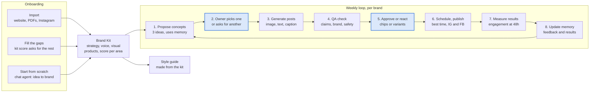
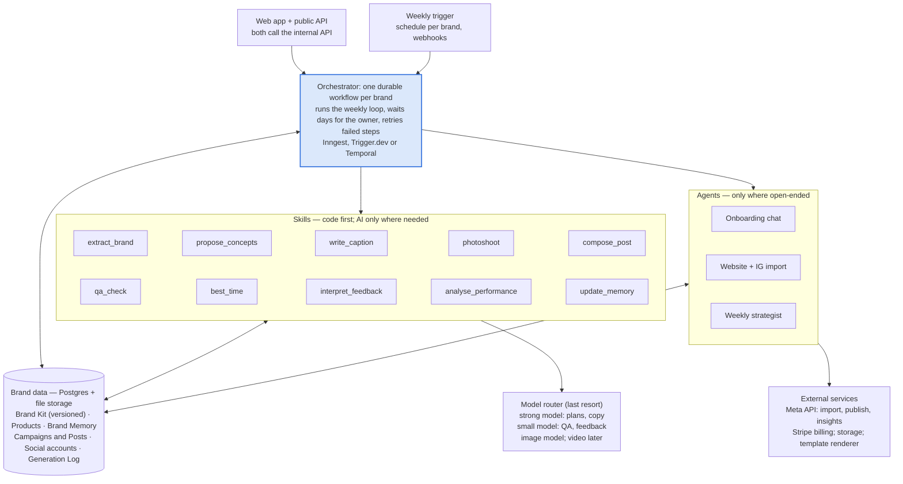

# Brandly — Product & Platform Scope

As of 11 Nov 2026 · Live version (with comments): [Claude Docs](https://claude.ai/artifact/W3izU19GSSo1YTNotYM3TC)

> This file is a snapshot of the scoping doc. If the two disagree, the live doc wins.

## Contents

1. [Summary](#summary)
2. [Starting point: the current repo](#starting-point-the-current-repo)
3. [Target user and promise](#target-user-and-promise)
4. [Competitive reference](#competitive-reference)
5. [User flows](#user-flows)
6. [Output, not editor: the feedback model](#output-not-editor-the-feedback-model)
7. [Scope](#scope)
8. [Architecture](#architecture)
9. [Cost efficiency](#cost-efficiency)
10. [Data model](#data-model)
11. [Learning loop and autonomy](#learning-loop-and-autonomy)
12. [Roadmap](#roadmap)
13. [Risks and open questions](#risks-and-open-questions)

## Summary

Brandly becomes a multi-user product that builds a small business's brand and then runs its Instagram and Facebook on autopilot: AI proposes, the owner approves, Brandly publishes and learns.

**Decisions made**

| Question | Decision |
| --- | --- |
| Who is the customer? | Solo founders and small businesses (SMB) |
| AI only, or AI plus human experts? | AI only. Users give structured feedback; they never edit outputs directly |
| Which channels? | Social only. Instagram and Facebook first, LinkedIn next, TikTok later |
| How is it built? | One durable workflow per brand calling single-purpose skills, with one shared memory per brand. Not a team of agents talking to each other |
| How do we keep it cheap? | Code first: most output comes from deterministic skills (templates, rules, stored data, reused assets). AI calls are the exception, batched and on the smallest model that works |
| Can others build on it? | Yes, through a public API and webhooks, shipped last (Phase 4). Every skill sits behind an internal API from day one so this is mostly packaging |

**The plan in one line:** fix and rebuild the foundations (logins, database, billing), then ship an MVP where a user goes from website or idea to a Brand Kit, product photos and a weekly batch of approved, auto-published posts.

## Starting point: the current repo

This repo is a single-commit prototype (27 Mar 2026). It's a Next.js 15 app with no live deployment: its only Vercel production build failed.

| Area | Status | Notes |
| --- | --- | --- |
| PDF catalogue analysis | Real | PDF.js renders pages in the browser; up to 8 pages go to Claude for image analysis |
| Website import | Mocked | Progress messages on timers; nothing is fetched |
| Instagram import | Mocked | Same; no API or scraper |
| Brand DNA | Partly real | Claude infers it from the name, URLs as text and any PDF results |
| Post composer | Real (text only) | Caption, hashtags, CTA, best time and an image *prompt*; no image is generated |
| Calendar | Real | Month/week views, drag to reschedule; nothing is published |
| RSS / recurring automation | Real | Product-page watcher imports a missing file (`lib/web`) |
| AI layer | Real | Claude first, Gemini fallback for text |
| Storage, logins, billing | Missing | All data lives in the browser (localStorage) |
| Build | Broken | Two bad imports in `app/api/automation/route.ts` (`../../lib/automation-utils` and `lib/web`), likely the cause of the failed deploy |

**Reuse:** the Brand DNA idea, PDF reader, composer prompts, calendar, platform previews and recurring automation. Roughly 35–40% of the MVP's concepts already exist; most implementation below the UI is rebuilt.

## Target user and promise

**Promise:** "Tell us about your business. We build your brand and run your social media. You just approve."

**Who:** solo founders and SMB owners with little time, no designer and no marketing team. Many sell physical products.

They arrive in one of three states, which all lead into the same Brand Kit:

1. **Know their brand:** they have a logo, colours, a story and maybe a website or catalogue.
2. **Know part of it:** for example a name and logo but no voice, palette or content plan.
3. **Know nothing:** just an idea, a product or an audience in mind.

**What this implies for the product:** few decisions per screen, choices instead of blank forms, mobile-friendly approval, low monthly price, and one account with one to three brands. Team roles and approvals are not needed in v1.

## Competitive reference

Google's Pomelli gives away on-brand asset generation for free, so Brandly must win on autopilot, publishing and learning, not on generation alone.

| | [Pomelli](https://labs.google.com/pomelli/) (Google Labs) | [Ocoya](https://www.ocoya.com/) |
| --- | --- | --- |
| Model | Free beta; English; US, CA, AU, NZ only | $29 / $79 / $199 per month; 300 / 1,500 / 5,000 credits |
| Onboarding | Website URL to a Business DNA card; chat agent for users without a website | Manual brand setup; product import |
| Creation | Product + audience to 3 campaign concepts; Photoshoot (product photo to 4 studio/lifestyle shots); Animate (9:16 only, text breaks) | AI captions, images, carousels, short video; own design editor |
| Editing | Font, colour, layout controls; "Fix Layout" button | Full design editor |
| Publishing | Mostly download; Instagram publishing reported Jun 2026, unconfirmed | About 20 networks, best-time scheduling |
| Other | Brand Books, logo concepts, website drafts | Social Inbox, workflows, API/MCP, Shopify/WooCommerce |
| Weak spots | No scheduling loop, no learning from results | Credit limits, usability and support complaints; analytics still being upgraded |

**Borrow:** website-first onboarding and a chat agent for from-scratch users (Pomelli); campaign concepts before posts (Pomelli); Photoshoot-style product images (Pomelli); products as first-class data (both); best-time scheduling and credits (Ocoya); AI-drafted comment replies, later (Ocoya).

**Avoid:** design editors and workflow builders; 20+ networks; websites, SEO articles and email.

**Differentiate:** plan → generate → approve → publish on autopilot; learning from each brand's feedback and engagement; markets and languages Pomelli doesn't serve.

Sources (as of Nov 2026; Pomelli details are mostly third-party): [Google blog: Photoshoot](https://blog.google/innovation-and-ai/models-and-research/google-labs/pomelli-photoshoot/) · [MindStudio review](https://www.mindstudio.ai/blog/google-pomelli-review-features-limitations) · [ScriptByAI](https://www.scriptbyai.com/pomelli-marketing-campaigns) · [Ocoya](https://www.ocoya.com/) · [Firebear: Ocoya guide](https://firebearstudio.com/blog/ocoya-review.html)

## User flows

Every user ends up with the same Brand Kit, then enters a weekly loop where the owner makes only two kinds of decision: pick a concept, and approve or react.

*Highlighted steps need the owner; everything else runs automatically.*

**Onboarding entry points**

1. **Import:** the user enters a website URL (the main path), uploads PDFs or a logo, and connects Instagram. AI extracts the Brand Kit; the user confirms each area with "looks right" or a reaction chip.
2. **Fill the gaps:** after import or a partial start, a completeness score per area (strategy, voice, visual, products) shows what's missing. Brandly asks short questions or offers 3 options for each gap.
3. **Start from scratch:** a chat agent works from idea or product to audience, positioning, name and slogan, story, voice, then palette, fonts and a simple logo. Each step is "pick one of 3, then react".

Products are added during onboarding from a URL or photo, and each one gets Photoshoot-style studio and lifestyle images.

**The weekly loop**

- Brandly proposes 3 campaign concepts (e.g. new product, weekend offer, behind the scenes). Concepts are cheap text, so images are only generated for ideas the owner wants.
- Generated posts are feed posts, carousels or Stories: an AI image with headline and logo composed by templates, plus caption and hashtags.
- If the owner doesn't respond, defaults apply according to their autonomy level (see [Learning loop and autonomy](#learning-loop-and-autonomy)).

## Output, not editor: the feedback model

Users react to outputs through a fixed set of controls; they never manipulate a design. Every reaction is stored and teaches the system.

| Users can | Users cannot |
| --- | --- |
| Approve or reject | Move, resize or restyle elements |
| Pick one of 2–3 variants | Pick fonts or colours freely |
| Regenerate only the caption or only the image | Edit text inside an image |
| Tap preset chips: "shorter", "more playful", "less salesy", "different photo style", "no emojis", "fix layout" | Upload their own designs as posts |
| Add an optional note ("mention the weekend sale"), which the AI turns into constraints | |

**Design rules that make this work**

- **No text inside generated images.** The image model makes the picture only; headlines and logos are composed on top by Brandly's own templates in the brand's fonts and colours. Text is always correct, so there is nothing to fix by hand. Pomelli's broken animated text confirms the approach.
- **One-tap fixes are system actions, not tools.** "Fix layout" or "bigger logo" re-run the template with a different setting.
- **Brand Kit choices work the same way:** names, slogans, palettes, logos and voice are offered as "pick one of 3, then react", never as blank forms.
- **Credits:** images and video cost credits; caption regenerations and concept picks are free, which avoids the credit complaints Ocoya gets.

Open question: allow a direct typo fix on the caption text only, or keep captions reaction-only too?

## Scope

Social media only. Of the ~60 services in the reference screenshots, about a dozen are in scope; the rest are later or out.

| Bucket | Services |
| --- | --- |
| **In (MVP and Phase 2)** | Brand Kit: name and slogan, voice and tone, palette, fonts, simple logo, auto-generated style guide. Products with Photoshoot-style images. Content plan and campaign concepts. Social copy and hashtags. Feed posts, carousels and Stories with composed text. Scheduling and auto-publishing. Engagement insights. Multi-language captions |
| **Later (Phase 3+)** | Animated posts and Reels, voice-over, UGC-style video, paid boosts, AI-drafted comment replies, Shopify product sync if not done earlier, public API and webhooks (Phase 4) |
| **Out** | Print, packaging, merch, business cards, websites and landing pages, search ads, PR and press releases, blog and long-form, email, white papers, human freelancers |

**Platforms, in order:** Instagram and Facebook (one Meta app review covers both) → LinkedIn → TikTok. X is deferred because of its API cost.

## Architecture

Build one durable workflow per brand that calls single-purpose skills, with all state in the brand's data. Use agents only where the work is open-ended. The loop still runs on its own; code, not agent conversations, drives it.

*Memory belongs to the brand, not to any agent, so every step sees the same preferences.*

**Why not a team of agents talking to each other**

- The loop is known in advance, so a workflow is cheaper, faster and more predictable than agents negotiating the next step.
- Each agent-to-agent handoff adds a chance of error, and failures are hard to trace.
- Agent chatter multiplies AI cost, which SMB prices of $20–80 a month can't absorb.
- A single-purpose skill can be tested and improved on its own; a conversation can't.
- Memory kept per agent drifts: the caption step learns "no emojis" but the image step never hears it.

**Skills**

| Skill | How it runs | AI calls |
| --- | --- | --- |
| `extract_brand` | Code parses the site's HTML and CSS for colours, fonts, logo, images and product data; one AI call summarises voice and positioning | Once per brand, and on re-import |
| `propose_concepts` | Concept library (launch, offer, behind the scenes, testimonial, seasonal) + occasion calendar + product rotation pick candidates; one AI call ranks and words 3 | 1 small call per week |
| `write_caption` | All of the week's captions in one structured call, with the Brand Kit as cached context; hashtags from a stored bank per niche | 1 call per batch |
| `photoshoot` | Image model, run once per product; results reused across many posts | Once per product |
| `compose_post` | Template engine renders layout, text, logo and colours over reused product images or backgrounds; variants are re-renders, not new generations | None, unless no reusable image fits |
| `qa_check` | Rules: prices and claims matched to product data, banned words, length and format limits; small model only on flagged posts | Rarely |
| `best_time` | Statistics from account insights; platform defaults until there is data | None |
| `interpret_feedback` | Each chip maps to a fixed constraint; small model only for free-text notes | Only for notes |
| `analyse_performance` | Database queries per template, concept type, product and time slot | None |
| `update_memory` | Counting rules turn the statistics into preference statements | None |

**Agents (an AI with tools, in a loop), each called by the orchestrator:** the onboarding chat for from-scratch users, website and Instagram import (deciding which pages and images matter), and an optional weekly strategist.

**Stack:** keep Next.js on Vercel. Add Supabase (Postgres, login, file storage), Inngest or Trigger.dev for durable workflows, Stripe for credits, a template renderer (HTML/SVG to PNG), and the Meta Graph API. A model router assigns a provider per skill; the repo's Claude/Gemini fallback (`lib/llm.ts`) is an early version. Later, the same skills can power a chat assistant ("plan a Diwali campaign") without changing the core.

**Public API (Phase 4):** from day one, every skill and workflow sits behind an internal, versioned API that the web app itself uses. The public API then mostly adds API keys, rate limits, usage billing and docs. Planned endpoints: brands and Brand Kit, products, generate (concepts, posts, photoshoot), schedule and publish, plus webhooks for post status and engagement. Other services or agencies can then run Brandly for their own brands.

## Cost efficiency

Most output comes from code, not AI calls. The design target is 2–3 text AI calls per brand per week, plus image generation only for new products or when no stored image fits.

1. **Code before AI.** If a step can be a template, rule, lookup or database query, it is one (see the Skills table).
2. **Generate once, reuse many times.** Product photoshoots, backgrounds and brand assets are stored and re-rendered into many posts and variants.
3. **Batch.** One call per weekly batch instead of one per post, using providers' cheaper batch processing for the non-urgent weekly run.
4. **Cache.** The Brand Kit and instructions are sent as cached context; identical inputs return stored results.
5. **Smallest model that passes the quality tests.** Large models only for brand extraction and performance analysis.
6. **Concepts before images.** No image spend on ideas the owner rejects.
7. **Learning moves work into code over time.** Winning templates, phrase patterns and hashtag sets per niche become library entries; frequent tasks can later move to small fine-tuned models.

**Guardrails:** AI cost per brand per month is tracked in the Generation Log, each plan has a monthly budget with hard caps, and brands that exceed it trigger an alert. Credits cover images and video.

Open question: what monthly AI cost per brand should we target? It sets pricing.

## Data model

Everything hangs off the Brand. Every skill reads the Brand Kit, Products and Brand Memory; nothing is stored inside an agent.

| Entity | Key contents | Notes |
| --- | --- | --- |
| Account / Workspace | User, plan, credit balance, 1–3 brands | No team roles in v1 |
| Brand Kit | Strategy (idea, audience, positioning, competitors, story, mission); verbal (name, slogan, voice, do's and don'ts); visual (logo files, palette, fonts, photo style); completeness score per area | Versioned: every change creates a new version, so outputs can be traced to the kit that made them |
| Products | Name, description, price, URL, photos, generated Photoshoot images | Imported from a URL first; Shopify later |
| Social Accounts | Connected Instagram and Facebook accounts and tokens | One connection serves import, publishing and insights |
| Brand Memory | Short preference statements, each with evidence, confidence and date ("rejected 4 of 5 posts with emojis") | Visible to the user and resettable |
| Campaigns | Goal, theme, products, dates, chosen concept | Weekly batches are made of campaigns |
| Posts | Format, image, composed creative, caption, hashtags, status, schedule, published IDs | Status: draft → approved → scheduled → published |
| Generation Log | Every skill call: inputs, prompt version, model, output, cost, feedback, later engagement | Basis for the learning loop and quality tests |

Terms of service must allow using generated content and feedback to improve models, from launch.

## Learning loop and autonomy

"Getting better over time" happens in two layers: per-brand memory from day one, cross-user model improvement once there is enough data.

**Layer 1: per-brand memory (MVP).** After each batch, `interpret_feedback` turns chips, rejections and notes into preference statements, and `update_memory` merges them with engagement results. The relevant statements are added to every skill's input. This is cheap and improves the next batch immediately.

**Layer 2: cross-user improvement (Phase 2+).** The generation log, aggregated across brands, is used in this order:

1. Improve prompts and templates, and measure each change against a fixed quality test set.
2. Track approval rate without edits, and engagement per post, as the headline quality metrics.
3. Train a ranking model that picks the best variants before users see them.
4. Fine-tune generation models once volume justifies it.

Engagement (saves, shares, reach) is the strongest signal because it measures results, not stated taste.

**Autonomy, earned per brand**

| Level | Behaviour | Unlocks when |
| --- | --- | --- |
| Approve all | Every post needs approval | Default |
| Autopilot offer | Posts publish unless rejected within a window (e.g. 24h) | Brand approves, say, 80%+ of posts without changes |
| Full autopilot | Concepts are picked and posts published automatically; weekly summary | User opts in |

At every level, the QA skill blocks prices, discounts or claims not found in product data, and anything off-brand or unsafe.

## Roadmap

The MVP (Phases 0 and 1) takes roughly 11–14 weeks with 2–3 engineers and 1 designer. These are planning ranges, not commitments; they become dates once team size and start date are set.

| Phase | Rough effort | Scope | Gate to move on |
| --- | --- | --- | --- |
| **0 Foundations** | 3–4 weeks | Fix build and deploy; logins, Postgres; file storage, job queue; credits + Stripe; Brand Kit schema; submit Meta app review; image model bake-off | Build green, Meta review submitted |
| **1 MVP** | 8–10 weeks | 3 onboarding paths; website + IG import; products and Photoshoot; weekly concepts; feed posts + Stories; feedback chips; IG + FB publishing; brand memory | Pilot brands publish every week |
| **2 Improve** | about 8 weeks | Carousels; engagement insights; autopilot mode; LinkedIn; Shopify product sync; multi-language; ranking from logs | Approval rate and margin on target |
| **3 Expand** | 10–12 weeks | Animate and Reels; voice-over; UGC-style video; paid boosts; comment replies; TikTok | — |
| **4 Public API** | 4–6 weeks | REST API + webhooks; keys, rate limits; usage billing, docs | — |

Gate targets (approval rate, cost per brand) are set during Phase 1 from pilot data.

**Start this week**

- [ ] Fix the two broken imports and get a green deploy
- [ ] Create the Meta developer app and start the app review
- [ ] Pick 3 image models for a bake-off on brand consistency, product fidelity and cost
- [ ] Recruit 5–10 pilot SMBs across product and service businesses

## Risks and open questions

| Risk | Impact | Mitigation |
| --- | --- | --- |
| Meta app review takes weeks or is rejected | No publishing or Instagram import at MVP | Submit in Phase 0; fall back to download plus reminders |
| Pomelli adds scheduling and learning for free | Weakens differentiation | Focus on results-based learning, non-US markets and languages, reliability |
| AI cost per brand exceeds price | Negative margin at SMB prices | Code-first skills and asset reuse (see Cost efficiency), concepts before images, credits for images and video, budget caps per plan |
| Weak website import for thin sites | Poor Brand Kit, poor first impression | Chat agent fills gaps; completeness score shows what's missing |
| Generated claims or prices are wrong | Trust and legal exposure | QA skill checks against product data; approval required until trust is earned |
| Logo quality from image models | Unusable logos | Keep logos simple (wordmark plus mark, 2 colours), vector output |
| Instagram API limits on personal accounts | Some users can't connect | Require a Business or Creator account; guide users through switching |

**Open questions**

- [ ] Which launch market(s) and languages?
- [ ] Pricing: target monthly price and credits per tier?
- [ ] Which image model and provider? Run a bake-off on brand consistency, product fidelity and cost.
- [ ] Allow direct caption typo fixes, or reactions only?
- [ ] Shopify sync in Phase 1 or Phase 2?
- [ ] Team size and start date, to turn the effort ranges into dates.
- [ ] Target monthly AI cost per brand?
